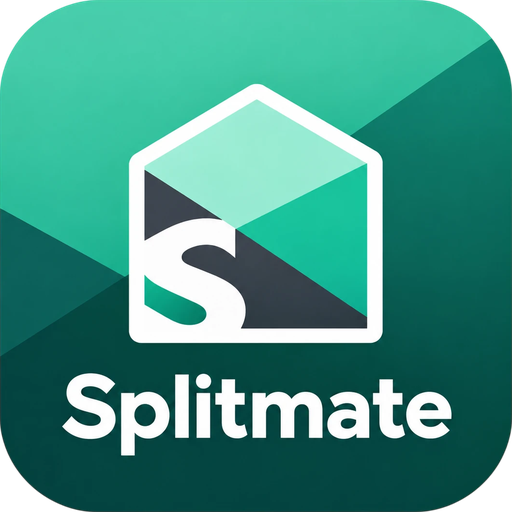

<p align="center">
  
</p>

<h1 align="center">SplitMate</h1>

<p align="center">
  Split expenses with friends, flatmates and travel groups.<br>
  <b>Offline-first. Peer-to-peer. No servers, no accounts, no analytics.</b>
</p>

<p align="center">
  
  
</p>

> **This app was made using Claude AI.** The code, tests and documentation in this repository were written with [Claude Code](https://claude.com/claude-code), Anthropic's AI coding assistant, working from a detailed specification and reviewed by a human. Please review and test it yourself before relying on it for real money, and see [Known limitations](#known-limitations).

---

SplitMate is a Flutter app for Android and iOS that keeps track of who paid for what and who owes whom. Unlike most expense-sharing apps, it has **no backend at all**. Your expenses live in a SQLite database on your phone, and phones share groups **directly with each other**, encrypted end to end. A Google Drive backup is available but entirely optional.

## Contents

- [Features](#features)
- [How it works](#how-it-works)
- [Using the app](#using-the-app)
- [Building from source](#building-from-source)
- [Production release (Android)](#production-release-android)
- [Building for iOS](#building-for-ios)
- [Optional: Google Drive backup](#optional-google-drive-backup)
- [Project structure](#project-structure)
- [Privacy and security](#privacy-and-security)
- [Known limitations](#known-limitations)
- [Documentation](#documentation)

## Features

**Expenses and balances**
- Groups for trips, flats or anything else, plus one-to-one expenses with a friend
- Split equally, by exact amounts, by percentage or by shares
- Amounts stored as whole minor units (paise, cents, fils), so there are no rounding surprises
- 18 currencies, each with its own precision; currencies are never mixed together
- Leftover cents are assigned the same way on every phone, so balances always agree
- Categories, notes, dates and receipt photos
- Full edit history for every expense
- "Simplify debts" suggestions that minimise the number of payments
- Record settlements (the app records payments; it never moves money)

**Sharing without a server**
- Start immediately: just type your name, no sign-up
- Pair phones with a QR code, then confirm a 6-digit code on both screens
- Share the QR as an image or text and upload it from the gallery or paste it
- Sync over the same Wi-Fi or hotspot, or directly over the internet (IPv6 or an automatically opened router port)
- Encrypted sync files for when the phones cannot reach each other
- Edits made offline on several phones merge automatically; real money conflicts are flagged for a person to decide

**Backup and recovery**
- Optional encrypted backup to your own Google Drive (private app folder) or to a file
- Restore merges with what is on the phone and never overwrites it
- Restoring onto a new phone brings back your identity, so friends' phones still recognise you

## How it works

```
 Phone A                                         Phone B
┌────────────────────────┐                     ┌────────────────────────┐
│ SQLite ledger          │   encrypted,        │ SQLite ledger          │
│ (signed change log)    │◄──────────────────► │ (signed change log)    │
│                        │   authenticated     │                        │
│ balances computed      │   direct sync       │ balances computed      │
│ locally                │                     │ locally                │
└────────────────────────┘                     └────────────────────────┘
            │ optional, encrypted
            ▼
   Google Drive app folder or a backup file
```

- **Every change is a signed record.** Adding, editing or deleting an expense creates a record identified by a hash of its contents and signed with your phone's key. The tables you see are rebuilt from these records, so two phones holding the same records always show exactly the same expenses and balances.
- **Balances are never synced.** Each phone calculates them from the expenses and payments it has.
- **Conflicts are not hidden.** If two people change the amount, payer or split of the same expense while offline, the app keeps a deterministic version so every phone agrees, marks the expense as conflicted and asks someone to choose. Edits to different fields (for example one person fixes the notes while another fixes the amount) merge on their own.
- **Only shared data is shared.** A phone receives a group only if its owner is a member of that group.

The full design, including the database schema, sync protocol and backup format, is in [docs/DESIGN.md](docs/DESIGN.md).

## Using the app

### First launch
1. Swipe through the short introduction.
2. Enter your name and tap **Get started**. A private key for your phone is created and stored in the phone's secure storage (Android Keystore or iOS Keychain).

Everything works offline from this point on.

### Groups and friends
- **Create a group:** Home or Groups tab, then **New group**. Pick a name and a default currency.
- **Add someone who does not have the app yet:** open the group, go to **Members**, then **Add someone without the app**. You can track their share right away and connect their phone later.
- **Friends outside a group:** Friends tab, then **Add friend**. This creates a private one-to-one group behind the scenes.
- **Admins** can rename or archive a group, make others admins and remove members. Removed members keep their history, so old balances stay correct.

### Adding an expense
1. Tap **Add expense**.
2. Choose the group or friend, enter a description and the amount, and pick who paid.
3. Choose how to split it:

   | Split | You enter | Example |
   | --- | --- | --- |
   | Equal | nothing | ₹1,200 for 3 people is ₹400 each |
   | Exact | each person's amount | ₹700 and ₹500 |
   | Percentage | each person's percentage | 50%, 30%, 20% |
   | Shares | a weight per person | 2 shares and 1 share |

   The form shows each person's share as you type and will not save until the numbers add up.
4. Optionally add a date, category, notes or a receipt photo, then **Save**.

### Settling up
Open a group and tap **Settle up**, or open **Balances** to see suggested payments. Pay the person however you like (cash, UPI, bank transfer), then record it in the app. A payment can be voided later but never edited, so the history stays honest.

### Connecting phones

**When you are together**
1. Phone A opens the group, goes to **Members**, then **Invite with a QR code** (or Account, then **Connect a phone**).
2. Phone B opens **Connect** and scans the code.
3. Both phones show a 6-digit code. If they match, tap **Codes match** on both.
4. The group syncs. Keep the screen open until it says it is done.

The phones need to be on the same Wi-Fi, or one phone can connect to the other's hotspot.

**When you are apart**
1. Phone A opens the invite screen and taps **Share code**, then sends it through any messaging app.
2. Phone B opens **Connect**, then **Scan**, and taps **Upload QR image** (or **Paste code**).
3. Compare the 6-digit code **on a voice call**, not in the chat you used to send the code.

This works when the phone showing the code is reachable over the internet: through public IPv6, or through a home router that allows apps to open a port automatically (UPnP or NAT-PMP). The connect screen tells you whether the phone is reachable over the internet. If it is not, try letting the other phone show the code instead.

**If nothing connects:** go to **Sync**, choose a paired device and pick **Send a sync file**. Send the file in any way you like. The other phone imports it from **Sync**, then **Import a sync file**. Only that phone can open it.

### Syncing again later
Open **Sync** on one phone and turn on **Let paired phones connect**. On the other phone choose **Scan, upload or paste a paired phone's sync code**. No new pairing or approval is needed.

The Home screen tells you how many of your changes have not reached any other phone yet.

### Resolving conflicts
If an expense was changed on two phones at the same time, a banner appears on the Home screen. Open **Conflicts** and choose the correct version. Everyone gets your choice the next time they sync. If two people recorded the same payment, you can void one of them or keep both.

### Backup and restore
Go to Account, then **Backup & restore**.
- **Google Drive:** connect your account, then **Back up now**. You can turn on an automatic daily backup.
- **File:** **Export encrypted backup file** and save it wherever you like.

Each backup is encrypted with a recovery passphrase that you choose. **It cannot be recovered if you forget it.**

**If you lose your phone:** install SplitMate on the new phone, choose **Restore from a backup file** on the welcome screen (or get started and restore from Google Drive in Backup), enter your passphrase, then sync with a friend to pick up anything newer than the backup.

**Without a backup:** a group admin can invite your new phone and use **Replace with a new phone** on your old member entry, which moves your old balances over to your new identity.

## Building from source

### Requirements

| Tool | Version |
| --- | --- |
| Flutter (stable) | 3.47 or newer, with Dart 3.13 |
| Android SDK | Platform 35 and 36, build tools 36 (minSdk 23) |
| Java | JDK 17 or newer |
| Xcode (iOS only, macOS) | 16 or newer, with CocoaPods |

Run `flutter doctor` to check your setup.

### Get the code and dependencies
```bash
git clone https://github.com/ashwinparasuram/splitmate.git
cd splitmate
flutter pub get
```

### Run the tests
The tests run on your computer, with no phone or emulator needed:
```bash
flutter test
```
They cover the split and balance maths, database migrations and transactions, sync convergence and conflicts, pairing and encryption, real TCP connections, router port mapping, backup and restore, and the main screens.

### Run on a device or emulator
```bash
flutter run
```

### Debug APK
```bash
flutter build apk --debug
```
The APK is written to `build/app/outputs/flutter-apk/app-debug.apk`.

### Build tips (Windows)
- Run **only one build at a time.** Two builds at once corrupt each other's caches.
- The first build downloads Gradle and Android dependencies and can take 10 to 20 minutes. Later builds are much faster.
- If a build fails with strange errors after an interrupted build, stop the Gradle daemons and clean:
  ```bash
  cd android && gradlew --stop && cd ..
  flutter clean
  flutter pub get
  ```
- Kotlin incremental compilation is turned off in `android/gradle.properties`, because it breaks when the project and the Flutter package cache are on different drives.

## Production release (Android)

### 1. Create a release key (once)
```bash
keytool -genkeypair -v -keystore D:\keys\splitmate-release.jks -keyalg RSA -keysize 2048 -validity 10000 -alias splitmate
```
`keytool` comes with the JDK (for example `C:\Program Files\Java\jdk-22\bin\keytool.exe`).

> **Back up the `.jks` file and its password.** If you lose them, you can never publish an update to the same app.

### 2. Point the build at your key
Copy `android/key.properties.example` to `android/key.properties` and fill in your passwords and the path to the `.jks` file. This file is ignored by git. Without it, release builds are signed with the debug key and the build prints a warning.

### 3. Build with a version
The version name is what users see. The build number must increase with every release.
```bash
flutter build apk --release --build-name=1.0.0 --build-number=1
```
Rename the result:
```bash
copy build\app\outputs\flutter-apk\app-release.apk splitmate-1.0.0.apk
```
You can also set the version in `pubspec.yaml` (`version: 1.0.0+1` means name 1.0.0, build 1) and leave out the two flags.

### 4. Google Play
Upload an App Bundle instead of an APK:
```bash
flutter build appbundle --release --build-name=1.0.0 --build-number=1
```
The bundle is written to `build/app/outputs/bundle/release/app-release.aab`.

## Building for iOS

iOS apps can only be built on a Mac (or with a cloud macOS service such as Codemagic or GitHub Actions macOS runners).

```bash
flutter pub get
cd ios && pod install && cd ..
open ios/Runner.xcworkspace
```
In Xcode, select **Runner**, then **Signing & Capabilities**, and choose your team. Change the bundle identifier if Xcode reports that it is taken. Then:

- Run on a connected iPhone: `flutter run --release`
- Build for TestFlight or the App Store (needs a paid Apple Developer account): `flutter build ipa --release`

If `pod install` complains about the minimum iOS version, set `platform :ios, '15.0'` in `ios/Podfile` and run it again.

## Optional: Google Drive backup

Everything except Drive backup works without any setup. To enable Drive backup:

1. Create a Google Cloud project and enable the **Google Drive API**.
2. Configure the OAuth consent screen with the scope `https://www.googleapis.com/auth/drive.appdata` (the app's private folder only).
3. Create OAuth clients:
   - **Android:** package `app.splitmate.splitmate` and the SHA-1 of your signing key. Add the SHA-1 of both your debug key and your release key.
   - **iOS:** bundle ID `app.splitmate.splitmate`. Replace the two `YOUR_IOS_CLIENT_ID` placeholders in `ios/Runner/Info.plist`.

To print the SHA-1 of your release key:
```bash
keytool -list -v -keystore D:\keys\splitmate-release.jks -alias splitmate
```

## Project structure

```
lib/
  core/        money and currencies, hybrid logical clock, canonical JSON
  domain/      split calculator, balance calculator, models
  data/        SQLite schema and migrations, ledger repository
  identity/    device keys and secure storage
  sync/        signed change log, merging and conflict detection, encrypted
               handshake, sync protocol, QR pairing, sync files,
               transports (TCP, IPv6, router port mapping)
  backup/      encrypted backup format, Google Drive and file storage
  app/         service wiring, sync controller, Riverpod providers
  ui/          theme, shared widgets and screens (GoRouter)
assets/branding/   logo and app icon sources
docs/              design, operations and known limitations
test/              unit, sync, networking, backup and UI tests
```

Built with Flutter, Riverpod, GoRouter, sqflite, `cryptography` (X25519, Ed25519, AES-256-GCM, Argon2id), mobile_scanner and qr_flutter.

To regenerate the app icons after changing the logo files in `assets/branding/`:
```bash
dart run flutter_launcher_icons
```

## Privacy and security

- **No servers, accounts or analytics.** Nothing is sent anywhere unless you sync with a friend or turn on Drive backup.
- **Only shared groups are shared.** A friend's phone receives only the groups they belong to. Receipt photos never leave your phone.
- **End-to-end encrypted sync.** Phones authenticate each other with their keys, and you confirm new connections by comparing a 6-digit code. Every change is signed, so a phone passing changes along cannot alter them.
- **Encrypted backups.** Backups are encrypted with your passphrase (Argon2id and AES-256-GCM) before they leave the phone. Drive access is limited to the app's own folder.
- **Kept out of system backups.** The database is excluded from Android Auto Backup and iCloud device backups, so it only leaves the phone through SplitMate's own encrypted backup.
- **Internet sync is optional.** While the Connect or Sync screen is open, the phone may advertise its public address and ask your router to open a port. You can turn this off in **Sync**.

## Known limitations

- Internet sync has no relay server, so it does not work everywhere. Two phones on mobile data without usable IPv6 usually cannot connect directly; use a shared Wi-Fi or hotspot, or a sync file.
- Sync only runs while the Sync or Connect screen is open (phones suspend network connections in the background).
- Receipt photos are not synced or backed up.
- The database is protected by the phone's own encryption and is not separately encrypted.
- The encrypted connection protocol is built from standard primitives and has not had an external security review yet.

The full list is in [docs/LIMITATIONS.md](docs/LIMITATIONS.md).

## Documentation

| Document | Contents |
| --- | --- |
| [docs/DESIGN.md](docs/DESIGN.md) | Architecture, database schema, sync protocol, conflict rules, authorisation, backup format |
| [docs/OPERATIONS.md](docs/OPERATIONS.md) | Building, permissions, Google setup, what happens when a phone is lost or reinstalled |
| [docs/LIMITATIONS.md](docs/LIMITATIONS.md) | What is not done or not yet verified |
